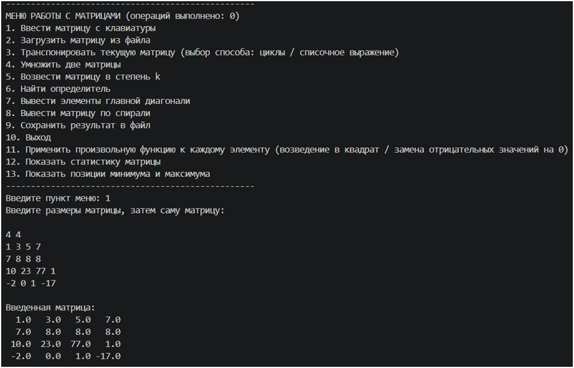
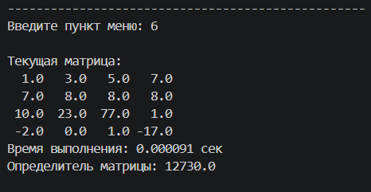
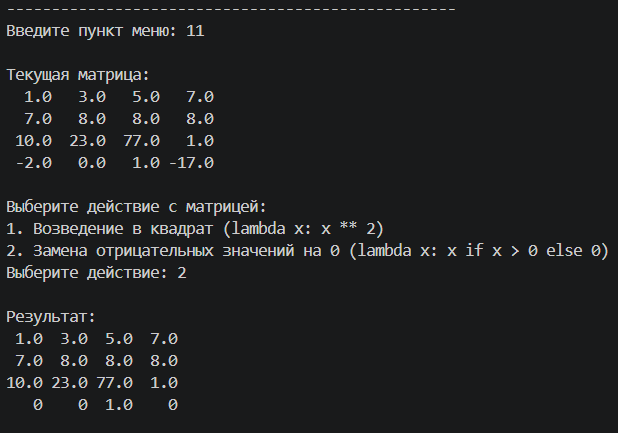
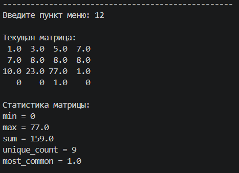
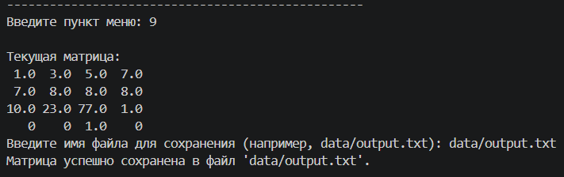
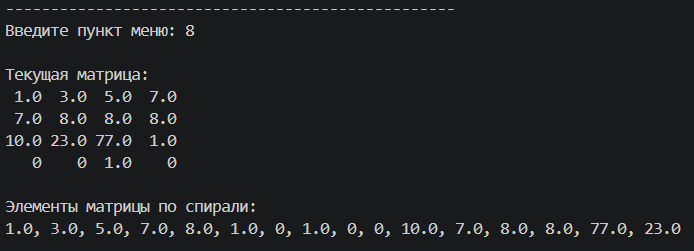
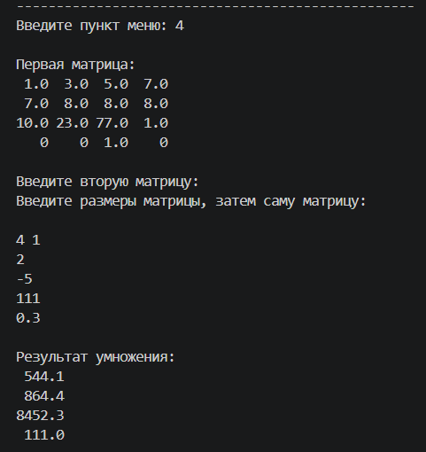
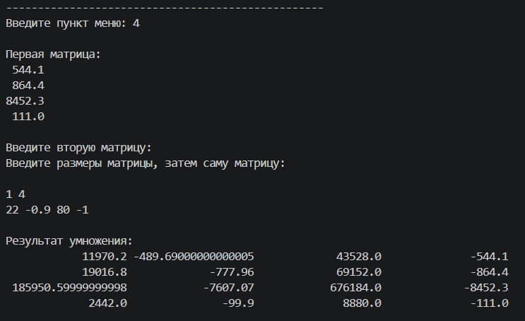
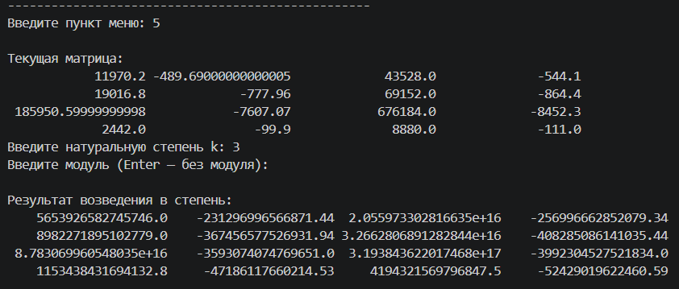

# Лабораторная работа №1: «Матричный калькулятор»

Консольное приложение для работы с матрицами.
Все матрицы хранятся как список списков (`list[list[int | float]]`).
Сторонние библиотеки не используются.

## Структура проекта

```text
matrix_lab/
├── main.py               # точка входа, интерактивное меню
├── matrix_utils.py       # вспомогательные утилиты
├── matrix_ops.py         # операции над матрицами
├── matrix_io.py          # генераторы для работы с матрицами
├── decorators.py         # декораторы
├── README.md             # описание проекта
├── images/               # папка скриншотов для README.md
└── data/                 # папка с входными/выходными файлами
    ├── input.txt
    └── output.txt
```

## Описание модулей

### `main.py`
Точка входа в программу. Реализует интерактивное меню на `while` и `if/elif`:
1. Ввод матрицы с клавиатуры.
2. Загрузка матрицы из файла.
3. Транспонирование (выбор способа: циклы / списочное выражение).
4. Умножение двух матриц.
5. Возведение в степень `k` с возможностью задать модуль.
6. Вычисление определителя.
7. Вывод главной диагонали (генератор `diagonal`).
8. Обход матрицы по спирали (генератор `spiral`).
9. Сохранение результата в файл.
10. Выход.
11. Применение лямбда-функции к каждому элементу (`lambda x: x ** 2`, `lambda x: x if x > 0 else 0`).
12. Статистика матрицы.
13. Позиции минимума и максимума.

Все ошибки ввода обрабатываются через `try/except` (`ValueError`, `FileNotFoundError`).
В заголовке меню отображается число выполненных операций из `get_stats()`.

### `matrix_utils.py`
- `read_matrix_from_console()` - построчный ввод через `sys.stdin`.
- `read_matrix_from_file(filename)` - чтение файла через менеджер контекста `with`.
- `write_matrix_to_file(matrix, filename)` - запись матрицы в файл с выравниванием.
- `print_matrix(matrix)` - красивый вывод в консоль по ширине самого длинного элемента.
- `max_element_lena(matrix)` - вспомогательная функция для вычисления ширины элемента.

### `matrix_ops.py`
- `transpose(matrix)` - транспонирование двумя способами: вложенные циклы и списочное выражение, с сравнением результатов.
- `multiply(a, b)` - умножение матриц через три вложенных цикла.
- `add(a, b)` / `subtract(a, b)` - поэлементные операции с проверкой размеров.
- `scalar_multiply(matrix, k)` - умножение на скаляр.
- `determinant(matrix)` - рекурсивное вычисление через разложение по первой строке, базовые случаи 1×1 и 2×2.
- `identity(n)` - единичная матрица через списочное выражение.
- `power(matrix, k, *, mod=None)` - быстрое рекурсивное возведение в степень, при наличии `mod` результат берётся по модулю.
- `apply_to_matrix(matrix, func)` - функция высших порядков.
- `matrix_stats(matrix)` - словарь со статистикой: `min`, `max`, `sum`, `unique_count`, `most_common`.
- `min_max_positions(matrix)` - кортеж позиций минимума и максимума `((i, j), (i, j))`.
- `OPS_COUNT` и `get_stats()` - подсчёт выполненных операций.

### `matrix_io.py`
- `matrices_generator(folder)` - генератор матриц из всех `.txt`-файлов папки через `os.listdir`.
- `flatten(matrix)` - генератор, разворачивающий матрицу в плоскую последовательность.
- `diagonal(matrix)` - генератор элементов главной диагонали.
- `spiral(matrix)` - генератор обхода по спирали по часовой стрелке от левого верхнего угла.

### `decorators.py`
- `@timer` - замеряет время функции через `time.perf_counter()` и выводит его в консоль.
- `@validate_square` - проверяет квадратность матрицы до вызова функции, иначе выбрасывает `ValueError`.

## Реализованные темы

- Коллекции: списки, словари, множества, кортежи.
- Вложенные циклы и списочные выражения.
- Функции высших порядков и лямбда-функции.
- Генераторы и инструкция `yield`.
- Декораторы.
- Рекурсия.
- Файловый и потоковый ввод/вывод (`with`, `sys.stdin`).
- Обработка исключений (`try/except`, `ValueError`, `FileNotFoundError`).
- Области видимости: `global`.
- Позиционные и именованные аргументы.
- Модульная структура проекта и импорт между модулями.

## Примеры запуска

Перейдите в папку с проектом (`matrix_lab`) и запустите программу:

```bash
python main.py
```

Пример входного файла `data/input.txt`:

```text
3 3
1 2 3
4 5 6
7 8 9
```

Загрузка матрицы из файла:

```text
Введите пункт меню: 2
Введите имя файла (например, data/input.txt): data/input.txt

Загруженная матрица:
1.0 2.0 3.0
4.0 5.0 6.0
7.0 8.0 9.0
```

Транспонирование матрицы:

```text
Введите пункт меню: 3

Текущая матрица:
1.0 2.0 3.0
4.0 5.0 6.0
7.0 8.0 9.0

Выберите способ транспонирования:
1. Через вложенные циклы
2. Через списочное выражение
Введите номер способа: 1
Результаты транспонирования совпадают.

Результат (через циклы):
1.0 4.0 7.0
2.0 5.0 8.0
3.0 6.0 9.0
```

Умножение матриц:

```text
Введите пункт меню: 4

Первая матрица:
1.0 4.0 7.0
2.0 5.0 8.0
3.0 6.0 9.0

Введите вторую матрицу:
Введите размеры матрицы, затем саму матрицу:

3 2
4 5
6 8
9 4

Результат умножения:
 91.0  65.0
110.0  82.0
129.0  99.0
```

Вывод элементов главной диагонали:

```text
Введите пункт меню: 7

Текущая матрица:
 91.0  65.0
110.0  82.0
129.0  99.0

Элементы главной диагонали:
91.0, 82.0
```

Вывод матрицы по спирали:

```text
Введите пункт меню: 8

Текущая матрица:
 91.0  65.0
110.0  82.0
129.0  99.0

Элементы матрицы по спирали:
91.0, 65.0, 82.0, 99.0, 129.0, 110.0
```

Применить произвольную функцию к каждому элементу:

```text
Введите пункт меню: 11

Текущая матрица:
 91.0  65.0
110.0  82.0
129.0  99.0

Выберите действие с матрицей:
1. Возведение в квадрат (lambda x: x ** 2)
2. Замена отрицательных значений на 0 (lambda x: x if x > 0 else 0)
Выберите действие: 1

Результат:
 8281.0  4225.0
12100.0  6724.0
16641.0  9801.0
```

Найти определитель квадратной матрицы:

```text
Введите пункт меню: 6

Текущая матрица:
 8281.0  4225.0
12100.0  6724.0
16641.0  9801.0
Ошибка: Матрица не квадратная: 3x2
```

Показать позиции минимума и максимума:

```text
Введите пункт меню: 13

Текущая матрица:
 8281.0  4225.0
12100.0  6724.0
16641.0  9801.0

Позиция минимума: (0, 1)
Позиция максимума: (2, 0)
```

## Скриншоты работы

### Пункт 1 - Ввести матрицу с клавиатуры



### Пункт 6 - Найти определитель



### Пункт 11 - Применение лямбда-функции



### Пункт 12 - Показать статистику матрицы



### Пункт 9 - Сохранить результат в файл



### Пункт 8 - Вывести матрицу по спирали



### Пункт 4 - Умножить две матрицы




### Пункт 5 - Возвести матрицу в степень k

